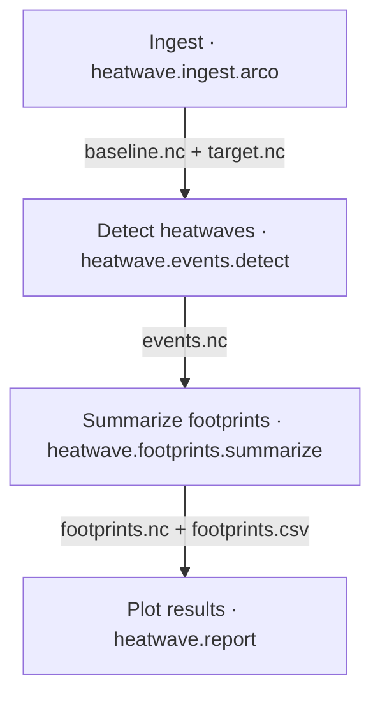

# Daily heatwave footprints around Milan

`heatwave` is a small Python library for tracking how much of the Milan area was affected by heatwaves in summer 2022. It compares ERA5-Land daily maximum temperatures with a local 1991–2020 reference. When a grid cell stays above its threshold for at least three days, the library marks those days and groups neighbouring hot cells into daily footprints. The result is a map of each footprint and a table of its area and peak temperature excess.

## Quick start

Run these commands from the repository root to install the library and open the worked example.

```bash
conda env create -f environment.yml
conda activate gprocessing-heatwave
python -m pip install -e .
jupyter lab notebooks/00_fixture.ipynb
```

The notebook uses the included synthetic data. For the real case, see [CDS setup](docs/cds-setup.md), [data access and sharing](docs/data.md) and [case commands](docs/workflow.md). Run `python -m pytest -q` for the offline tests.

## Call flow



The report also reads `target.nc` and `events.nc`. Case data goes in `data/processed/milan/` and figures go in `reports/milan/`.

## Repository tree

```text
.
├── .gitignore                         # Excludes local data, outputs and build files.
├── AGENTS.md                          # Team ownership and contribution rules.
├── environment.yml                    # Conda dependencies.
├── LICENSE                            # GNU GPL v3 licence.
├── pyproject.toml                     # Package metadata, dependencies and pytest settings.
├── README.md                          # Project overview, quick start and file guide.
├── .github/
│   ├── pull_request_template.md       # Pull request checklist.
│   ├── scripts/
│   │   └── check_publication.py       # Checks outgoing commit identities and tracked paths.
│   └── workflows/
│       └── tests.yml                  # Runs automated tests on GitHub.
├── data/
│   └── examples/
│       ├── pilot_milan_cell.csv       # Seven ERA5-Land daily maxima at one Milan grid cell.
│       └── synthetic/
│           ├── baseline_fixture.nc    # Synthetic reference temperatures.
│           ├── events_fixture.nc      # Expected synthetic heatwave layers and flags.
│           ├── target_fixture.nc      # Synthetic temperatures with hot spells and missing data.
│           └── worked_example.csv     # Expected heatwave flags and footprint IDs.
├── docs/
│   ├── cds-setup.md                   # CDS token and environment setup.
│   ├── data.md                        # How to get and share Milan inputs.
│   ├── geography.md                   # Study area and how to read the figures.
│   ├── v1.md                          # File formats, fields and units between stages.
│   └── workflow.md                    # Milan commands, tests and troubleshooting.
├── notebooks/
│   ├── 00_fixture.ipynb               # Walks through the synthetic example.
│   ├── 00_pilot.ipynb                 # Maps the seven-day CDS pilot.
│   └── 01_case.ipynb                  # Shows the Milan case figures.
├── src/
│   └── heatwave/
│       ├── __init__.py                # Initializes the heatwave package.
│       ├── _handoff.py                # Checks shared NetCDF fields and stages output files.
│       ├── report.py                  # Plots temperatures, affected area and footprints.
│       ├── events/
│       │   ├── __init__.py            # Initializes the events package.
│       │   └── detect.py              # Calculates thresholds and flags heatwave days.
│       ├── footprints/
│       │   ├── __init__.py            # Initializes the footprints package.
│       │   └── summarize.py           # Labels connected hot cells and summarizes their area.
│       └── ingest/
│           ├── __init__.py            # Initializes the ingest package.
│           ├── arco.py                # Converts hourly ARCO temperatures to daily maxima.
│           ├── cache.py               # Finds cached CDS files and opens NetCDFs in ZIPs.
│           ├── check.py               # Validates Milan inputs and compares them with the CDS pilot.
│           ├── download.py            # Downloads CDS data or imports a browser download.
│           ├── normalize.py           # Converts cached CDS data into standard input files.
│           ├── provider.py            # Converts CDS fields into a standard Celsius dataset.
│           └── requests.py            # Defines Milan bounds, dates and CDS request parameters.
└── tests/
    ├── build_fixtures.py              # Rebuilds the synthetic examples.
    ├── real/
    │   ├── conftest.py                # Locates Milan data for integration tests.
    │   ├── test_case.py               # Recomputes and validates the full Milan case.
    │   ├── test_pilot.py              # Compares the CDS pilot with the sample CSV.
    │   └── test_raw_handoff.py        # Compares normalized temperatures with raw CDS files.
    └── unit/
        ├── test_arco.py               # Tests hourly-to-daily aggregation.
        ├── test_download.py           # Tests requests, cache reuse and downloads.
        ├── test_events.py             # Tests heatwave detection on synthetic data.
        ├── test_footprints.py         # Tests footprint labels and area totals.
        ├── test_ingest_check.py       # Tests whether the input checker catches missing dates.
        ├── test_normalize.py          # Tests conversion of cached CDS files.
        └── test_report.py             # Tests plot inputs and image exports.
```
